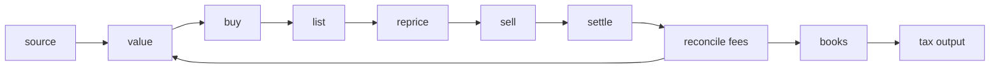
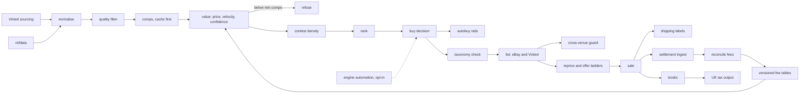

# Resell-Arbitrage-Platform

> A complete resale trading desk: multi-venue sourcing, comparable-sales valuation with velocity and confidence, cross-venue listing and repricing, shipping-label automation, settlement reconciliation, double-entry books and UK tax output — plus an opt-in low-latency automation engine, shipped disabled.

[](https://github.com/henryhorton19-web/Resell-Arbitrage-Platform/actions/workflows/ci.yml)
[](https://github.com/henryhorton19-web/Resell-Arbitrage-Platform/actions/workflows/codeql.yml)
[](LICENSE)
[](https://www.python.org/)
[](#testing-and-quality-gates)
[](#testing-and-quality-gates)

```
listing → normalise → comps → value + velocity + confidence → contest check → buy
        → list (eBay + Vinted) → reprice → sell → settle → reconcile → books → tax
```

## At a glance

| | |
|---|---|
| **What** | End-to-end resale arbitrage platform: sourcing, valuation, listing, repricing, books, tax |
| **Stack** | Python 3.12 · FastAPI · SQLAlchemy · Alembic · Typer · curl_cffi · uv |
| **Scale** | 20,329 lines · 53 modules · 16 CLI commands · 24 HTTP routes · 57 test modules |
| **Tests** | 629 passed · 87.77% coverage against an enforced 85% floor |
| **Quality gates** | ruff · ruff format · mypy strict · custom guard · CodeQL · SHA-pinned actions |
| **Money** | integer pence end to end; a float never touches a price |
| **Licence** | MIT |

## Contents

[Why](#why) · [The goal](#the-goal) · [Feature surface](#feature-surface) · [Quickstart](#quickstart) · [Architecture](#architecture) · [Design decisions](#design-decisions) · [Configuration](#configuration) · [Testing](#testing-and-quality-gates) · [Engineering](#engineering) · [The automation engine](#the-automation-engine) · [Terms of service](#terms-of-service)

## Why

Resale arbitrage is an information problem wearing the costume of an effort problem. Finding
listings is trivial and getting cheaper every year. The hard questions are what a specific item is
actually worth, how long it will take to sell, how much of the spread the platforms will take, and
how many other buyers are already looking at the same listing.

Every one of those is answerable with data, and every one of them is answered badly by the
spreadsheet-and-instinct approach most resellers use. Worse, the errors compound in one direction:
optimistic valuations, forgotten fees and ignored sell-through time all overstate margin, so a
business that feels profitable in a spreadsheet loses money in a bank account.

This platform is the other approach. Value items from actual comparable sales rather than asking
prices. Carry velocity and confidence alongside the number, and refuse to produce a number at all
when the comparable set is too thin. Measure fees from settlement data rather than assuming
published rates. Keep every purchase, sale, fee and return in books that reconcile, and produce tax
output from those books rather than from memory in April.

## The goal

Close the whole loop from a listing you have not seen to a tax return you can file, with every
number in between traceable to where it came from.



The feedback edge matters: measured settlement fees replace assumed ones, so valuations get more
accurate as the business runs rather than staying frozen at whatever the published rate card said.

## Feature surface

Eight subsystems. Every capability maps to a module in this repository.

### Sourcing

| Capability | Where |
|---|---|
| Vinted buy-venue adapter, shaped from the wrapper's own dataclasses | `src/arb/sourcing/vinted.py` |
| The scanner: one pure function, which is why automation is additive later | `src/arb/sourcing/scanner.py` |
| Candidate scoring and ranking | `src/arb/sourcing/rank.py` |
| Quality filtering — exclude listings that will not resell cleanly | `src/arb/sourcing/quality.py` |
| **Contest density** — how many other buyers are chasing the same listing | `src/arb/sourcing/contest.py` |
| Active-listing sweep, measuring how long things actually take to sell | `src/arb/sourcing/sweep.py` |
| Monitors: a scheduler and a seen-set diff wrapped around the scanner | `src/arb/monitor.py` |
| Deterministic normalisation of free text into blocking keys | `src/arb/norm.py` |
| Vinted ID reference tables loaded into a local lookup | `src/arb/refdata.py` |

### Valuation

| Capability | Where |
|---|---|
| **Price, velocity and confidence** — not just a number | `src/arb/comps/valuation.py` |
| Comparable-sale matching against a candidate item | `src/arb/comps/matching.py` |
| Comp acquisition, cache-first | `src/arb/comps/service.py` |
| Append-only comps cache | `src/arb/comps/cache.py` |
| SoldComps adapter, contract verified against published docs | `src/arb/comps/soldcomps.py` |
| **Backtest: does `value()` actually predict what things sell for?** | `src/arb/comps/backtest.py` |
| Versioned, content-hashed fee tables, provisional until settlement data lands | `src/arb/comps/fees.py` |
| The placeholder register — which numbers here are still assumptions | `src/arb/provenance.py` |

### Buy side

| Capability | Where |
|---|---|
| Buy-side pipeline: fetch, price, rank | `src/arb/pipeline.py` |
| Decisions recorded, not just taken | `src/arb/repo.py` |
| **AutoBuy rails** — everything that must be true before money moves automatically | `src/arb/autobuy.py` |
| Hazard checks | `arb hazard-check` |

### Sell side

| Capability | Where |
|---|---|
| **eBay taxonomy compliance — refuse to publish a listing eBay will not index** | `src/arb/selling/taxonomy.py` |
| Taxonomy aspect cache | `src/arb/selling/aspects_repo.py` |
| Repricing and offer ladders, one valuation engine used from the other end | `src/arb/selling/reprice.py` |
| Vinted as a second sell venue | `src/arb/selling/vinted_sell.py` |
| **Cross-venue reconciliation — never sell the same item twice** | `src/arb/selling/crossvenue.py` |
| Settlement ingestion: what eBay actually charged, versus what was assumed | `src/arb/selling/finances.py` |
| **Shipping labels: detect the carrier, crop to the label, merge into one batch** | `src/arb/selling/labels.py` |

### Books, reconciliation and tax

| Capability | Where |
|---|---|
| The books: what is owned, what it cost, what came back, and what is stuck | `src/arb/books/ledger.py` |
| **Fee reconciliation — replace invented rates with measured ones** | `src/arb/books/reconcile.py` |
| **UK tax output**, a preparation aid and deliberately not a filing | `src/arb/books/tax.py` |
| Verticals and a synthetic seed for exercising the whole loop | `src/arb/books/verticals.py` |
| Integer-pence money type; a float never touches a price | `src/arb/money.py` |

### Interfaces

| Capability | Where |
|---|---|
| 16-command CLI | `src/arb/cli.py` |
| REST API over the existing services, no business logic in the layer | `src/arb/web/api.py` |
| Engine telemetry and control bridge | `src/arb/web/api_engine.py` |
| Self-contained single-file HTML dashboard | `src/arb/dashboard.py` |
| Venue protocols — the one forward-compatibility concession | `src/arb/protocols.py` |

### CLI, in full

```
arb version        arb doctor          arb load-refdata    arb seed
arb scan           arb buylist         arb decide          arb hazard-check
arb reprice        arb labels          arb reconcile-fees  arb provenance
arb books          arb tax             arb dashboard       arb web
```

### The automation engine — opt-in, disabled by default

| Capability | Where |
|---|---|
| Low-latency monitor worker for listing polling | `engine/monitor.py` |
| TLS and JA3 impersonation client | `engine/tls.py` |
| Proxy pool manager with round-robin rotation and failure quarantine | `engine/proxy.py` |
| CAPTCHA solving pipeline via CapSolver or 2Captcha | `engine/captcha.py` |
| AdsPower browser-profile management client | `engine/adspower.py` |
| AutoCop: automated checkout over the Vinted and Adyen payment flow | `engine/autocop.py` |
| Multi-channel cross-lister with auto-delist synchronisation | `engine/crosslister.py` |
| Standalone engine CLI: `monitor`, `autocop`, `delist`, `adspower-status` | `engine/cli.py` |

Every capability here is feature-flagged behind `ARB_ENGINE_*` and ships disabled. The 629-test
suite passes with zero engine surface active. See [Terms of service](#terms-of-service).

## Quickstart

```bash
git clone https://github.com/henryhorton19-web/Resell-Arbitrage-Platform.git
cd Resell-Arbitrage-Platform

uv sync                     # install, locked
uv run arb db upgrade       # create the database
uv run arb doctor           # report what is configured and what is missing
```

`doctor` runs with no credentials at all. A missing key means one step is unavailable, not that the
tool is broken. Copy `.env.example` to `.env` and fill in only what you need.

```bash
uv run arb seed             # synthetic vertical, exercises the whole loop offline
uv run arb scan             # sourcing pass
uv run arb decide           # valuation and buy/skip
uv run arb books            # the ledger
uv run arb dashboard        # write the single-file HTML dashboard
uv run arb web              # or serve the REST API
```

## Architecture

Four hard boundaries — sourcing, valuation, selling, books — each addressable in isolation.
Everything crosses them through `src/arb/protocols.py`, which is what makes 629 tests possible
without touching a live marketplace. The automation engine in `engine/` is a separate surface
bolted to the same protocols, which is why it can be absent without the core noticing.



**One item, end to end.** A listing arrives from `sourcing/vinted.py`. `norm.py` reduces free text
to blocking keys and resolves brand, size and condition against `refdata.py`. `sourcing/quality.py`
drops listings that will not resell cleanly. `comps/service.py` retrieves comparable completed
sales, cache-first. `comps/valuation.py` returns three things — expected price, expected velocity,
and a confidence — and returns nothing at all when the comparable set is below `ARB_MIN_COMP_N`.
`sourcing/contest.py` estimates how many other buyers are on the same listing, and
`sourcing/rank.py` orders what survives. On purchase, `selling/taxonomy.py` refuses to publish
anything eBay will not index, `selling/crossvenue.py` guarantees the item cannot be sold twice
across venues, and `selling/reprice.py` runs offer ladders using the same valuation engine from the
sell side. `selling/labels.py` detects the carrier, crops to the label and merges the day's
shipments into one batch. When eBay settles, `selling/finances.py` ingests what was actually
charged and `books/reconcile.py` replaces the assumed fee rate with the measured one — which feeds
back into every future valuation. `books/ledger.py` carries the position and `books/tax.py`
produces UK output from it.

<details>
<summary>Full module map</summary>

| Path | Responsibility |
|---|---|
| `src/arb/cli.py` | Typer CLI, 16 commands |
| `src/arb/pipeline.py` | buy-side orchestration |
| `src/arb/sourcing/` | Vinted adapter, scanner, ranking, quality, contest density, sweep |
| `src/arb/comps/` | valuation, matching, cache, SoldComps adapter, fee tables, backtest |
| `src/arb/selling/` | taxonomy compliance, aspects cache, reprice, Vinted sell, cross-venue, finances, labels |
| `src/arb/books/` | ledger, fee reconciliation, UK tax, verticals and synthetic seed |
| `src/arb/norm.py` | deterministic normalisation into blocking keys |
| `src/arb/refdata.py` | platform reference tables, advisory lookup only |
| `src/arb/money.py`, `models.py` | integer-pence money, domain models |
| `src/arb/monitor.py` | scheduler and seen-set diff |
| `src/arb/autobuy.py` | preconditions before automated spend |
| `src/arb/provenance.py` | placeholder register: which numbers are still assumptions |
| `src/arb/store.py`, `repo.py`, `db.py`, `migrations/` | persistence, SQLAlchemy, Alembic |
| `src/arb/protocols.py` | venue protocols |
| `src/arb/web/` | FastAPI app, REST surface, engine bridge |
| `src/arb/dashboard.py` | single-file HTML dashboard |
| `engine/` | opt-in automation: monitor, TLS, proxy pool, CAPTCHA, AdsPower, AutoCop, cross-lister |
| `tests/`, `tests_engine/` | 57 test modules |
| `scripts/guard.py` | custom CI gate |

</details>

## Design decisions

### Precision over recall: the system refuses rather than guesses
`ARB_MIN_COMP_N` sets a floor on comparable sales below which no valuation is produced. The
rejected alternative was the conventional one — always return a number with a confidence score.
That fails in practice because a low-confidence number still gets acted on, and the cost of a bad
buy is real money while the cost of a skipped opportunity is zero.

### A valuation is three numbers, not one
`comps/valuation.py` returns expected price, expected velocity, and confidence. Price alone is what
makes resellers buy slow-moving stock at a good margin and then run out of cash. Velocity turns
margin into annualised return, which is the figure that actually matters.

### Fee rates are measured, then replace the assumptions
Fee tables are versioned YAML, content-hashed, and explicitly marked provisional until settlement
data arrives. `books/reconcile.py` then substitutes measured rates. The rejected alternative — a
single current rate card — silently overstates margin, and does so in the direction that loses
money.

### Every number carries its provenance
`src/arb/provenance.py` is a placeholder register: it tracks which figures in the system are
measured and which are still assumptions, and `arb provenance` prints the list. This is the
difference between a model you can audit in six months and one you have to trust.

### Money is integer pence, and a float never touches a price
Stated twice in the codebase because it matters twice. `money.py` and `models.py` both enforce it.
Floating-point money is a bug that manifests as a rounding discrepancy nobody can reproduce.

### Reference data is an advisory lookup, never an allowlist
The `VintedRef` docstring in `src/arb/db.py` states it directly: the public brand seed is incomplete
and missing several high-value resale names. Safe as a normalisation lookup, unsafe as a filter —
membership filtering would silently discard exactly the stock worth buying.

### The scanner is one pure function, which is why automation is additive
`sourcing/scanner.py` takes inputs and returns candidates, with no side effects. That is what
allowed the entire `engine/` layer to be built later as an opt-in addition rather than a rewrite,
and what keeps 629 tests running with no network.

### Automation is opt-in, and the tests prove it
Every engine capability is feature-flagged behind `ARB_ENGINE_*` and defaults to disabled. The suite
passes with zero engine surface active, so the automation layer cannot silently become
load-bearing. Turning any of it on is an explicit, auditable act.

### Supply chain pinned by SHA, not tag
GitHub Actions are pinned to commit SHAs rather than version tags, because tags are mutable. CodeQL
runs on a schedule as well as on push. Dependabot is enabled, which is why dependency PRs appear
against this repository.

## Configuration

Copy `.env.example` to `.env`. All credentials are optional; absent means one step is unavailable.

| Variable | Default | Purpose |
|---|---|---|
| `ARB_MIN_COMP_N` | `3` | Minimum comparable sales before a valuation is produced |
| `ARB_DB_PATH` | `arb.db` | SQLite database location |
| `ARB_VINTED_REQUESTS_PER_SECOND` | `1.5` | Sourcing rate limit |

<details>
<summary>All environment variables</summary>

| Variable | Default | Purpose |
|---|---|---|
| `ARB_DB_PATH` | `arb.db` | SQLite database location |
| `ARB_DATA_DIR` | `data` | Reference data and cache directory |
| `ARB_VINTED_BASE_URL` | `https://www.vinted.co.uk` | Marketplace endpoint |
| `ARB_VINTED_REQUESTS_PER_SECOND` | `1.5` | Sourcing rate limit |
| `ARB_SOLDCOMPS_API_KEY` | empty | Comparable-sales provider; absent disables comps lookup |
| `ARB_APIFY_TOKEN` | empty | Scraping infrastructure; absent disables that source |
| `ARB_ANTHROPIC_API_KEY` | empty | Listing normalisation and titling; absent disables it |
| `ARB_EBAY_REST_CONFIG` | `ebay_rest.json` | Path to eBay credentials; see `ebay_rest.json.example` |
| `ARB_MIN_COMP_N` | `3` | Minimum comparable sales before a valuation is produced |

Engine capabilities are configured separately under the `ARB_ENGINE_*` prefix and default to
disabled.

</details>

## Testing and quality gates

```bash
uv sync --frozen
uv run pytest                        # 629 passed, coverage 87.77%
uv run ruff check .
uv run ruff format --check .
uv run mypy
uv run python scripts/guard.py
```

All six commands pass on a clean clone. Coverage is enforced at a minimum of 85%; the suite
currently reports 87.77%, and a drop below the floor fails the build rather than warning.

## Engineering

629 tests across 57 modules, none of which touch a live marketplace — every external surface sits
behind a protocol in `src/arb/protocols.py` with a test double.

`mypy` runs with `redundant-expr`, `truthy-bool`, `ignore-without-code`, `possibly-undefined` and
`explicit-override` all enabled, which is stricter than the default and catches a class of bug that
ordinary type checking does not. `ruff` runs with a broad rule selection and per-file carve-outs
rather than blanket suppression.

Beyond the standard tooling: a custom gate in `scripts/guard.py`, CodeQL on push and on a schedule,
GitHub Actions pinned by commit SHA, Alembic migrations under version control, a synthetic vertical
seed so the full loop runs offline, and Dependabot active.

## Integrations

| Service | Used for |
|---|---|
| Vinted | buy-side discovery and second sell venue |
| eBay, via `ebay_rest` | primary sell venue, sold comps, settlement data |
| sold-comps | comparable sale prices |
| Apify | scraping infrastructure |
| Anthropic API | listing normalisation and titling |
| CapSolver, 2Captcha | CAPTCHA solving; opt-in, disabled by default |
| AdsPower | browser profile isolation; opt-in, disabled by default |

## Terms of service

Automated access to Vinted and eBay is against those platforms' terms. The exposure is the account,
so any account used here should be kept separate from anything you cannot afford to lose. Every
engine capability is feature-flagged via `ARB_ENGINE_*` and ships disabled. No credentials,
accounts, proxies, CAPTCHA balances or session state are in this repository or its history.

## Reference data

`tests/fixtures/vinted_ref/` contains real public platform reference rows — brand, catalog, colour,
country, size and status IDs. They are retained deliberately: `src/arb/refdata.py` maps IDs to
titles and `tests/test_refdata.py` asserts on the values, so substituting placeholders would break
normalisation. They are an advisory lookup and never a brand allowlist.

## What is not in this repo

No API keys, no `.env`, no `ebay_rest.json`, no database, no ledger, no purchase history. Copy
`.env.example` and `ebay_rest.json.example` and fill them in locally. `uv run arb doctor` reports
what is configured and what is missing, and `uv run arb seed` builds a synthetic vertical so the
whole loop can be exercised with nothing configured at all.

## Further reading

- [`docs/SPEC.md`](docs/SPEC.md) — module contracts
- [`docs/CONTRACTS.md`](docs/CONTRACTS.md) — boundary interfaces
- [`docs/SCOPE.md`](docs/SCOPE.md) — what is in and out of scope
- [`docs/POLICY.md`](docs/POLICY.md) — standing engineering policy
- [`docs/PRECEDENTS.md`](docs/PRECEDENTS.md) — open-source sources evaluated, including the ones that did not earn their place and why
- [`docs/ROADMAP.md`](docs/ROADMAP.md)

## Licence

MIT — see [LICENSE](LICENSE).
